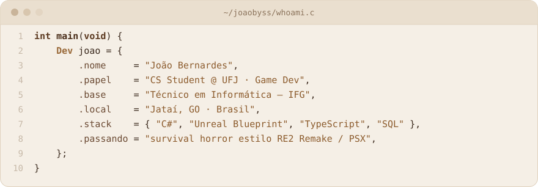

<picture>
  <source media="(prefers-color-scheme: dark)" srcset="https://capsule-render.vercel.app/api?type=rect&color=2B2B2B&height=200&section=header&text=Jo%C3%A3o%20Bernardes&fontSize=64&fontColor=E8D5B7&desc=dev%20%E2%80%A2%20game%20dev%20%E2%80%A2%20cs%20student&descSize=22&descAlignY=74&fontAlignY=42">
  
</picture>

<h3><i>made slowly, like good coffee. ☕</i></h3>

 

## `void joao() {`

<picture>
  <source media="(prefers-color-scheme: dark)" srcset="./assets/whoami-dark.svg">
  
</picture>

## `}`

- 🕯️ Faço jogos desde **2019**, principalmente **terror** — hoje na **Unreal** e na **Unity**.
- 🗄️ Construindo minha base em **web e banco de dados**: aprendendo SQL a fundo e Next.js.
- 🤝 Aberto a **oportunidades como dev júnior**, freelas, networking e colaborações.

 

## 🧰 Stack

 

## 📂 Projetos

<table>
<tr>
<td width="38%"><h3><a href="https://github.com/exgde/biblioteca-sql">biblioteca-sql</a></h3><code>banco de dados</code> <code>MySQL</code></td>
<td>Modelagem de um sistema de biblioteca, do diagrama às consultas.</td>
</tr>
<tr>
<td width="38%"><h3><a href="https://github.com/exgde/lucky38-blackjack">lucky38-blackjack</a></h3><code>web</code> <code>HTML</code> <code>CSS</code> <code>JS</code></td>
<td>Blackjack no navegador com cara de paciência clássica e clima de Fallout: New Vegas.</td>
</tr>
<tr>
<td width="38%"><h3>Darkness Framework</h3><code>Unreal 5</code> <code>Blueprint</code> <code>em desenvolvimento</code></td>
<td>Base de terror em terceira pessoa: motion matching, lanterna, interação e armas com recoil procedural.</td>
</tr>
</table>

 

## 🎮 Jogos publicados

<table>
<tr>
<td width="38%"><h3><a href="https://joaobyss.itch.io/goldspotting">Goldspotting</a></h3><code>Unity</code> <code>itch.io</code> <code>2026</code></td>
<td>Meu primeiro jogo lançado publicamente.  </td>
</tr>
</table>

 

<h4>feito por joaobyss · ☕</h4>

