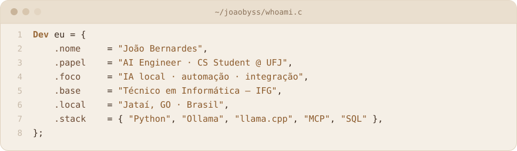

<picture>
  <source media="(prefers-color-scheme: dark)" srcset="https://capsule-render.vercel.app/api?type=rect&color=2B2B2B&height=200&section=header&text=Jo%C3%A3o%20Bernardes&fontSize=64&fontColor=E8D5B7&desc=ai%20engineer%20%E2%80%A2%20automa%C3%A7%C3%A3o%20%E2%80%A2%20cs%20student&descSize=22&descAlignY=74&fontAlignY=42">
  
</picture>

<h3><i>made slowly, like good coffee.</i></h3>

 

<picture>
<source media="(prefers-color-scheme: dark)" srcset="./assets/matrix-dark.svg">

</picture>

## `void joao() {`

<picture>
  <source media="(prefers-color-scheme: dark)" srcset="./assets/whoami-v3-dark.svg">
  
</picture>

## `}`

Rodo LLMs na minha própria máquina desde 2023. Hoje meu foco é **AI engineering**: automação e integração inteligente entre modelos, ferramentas e sistemas.

Antes da IA vieram os jogos, que faço desde 2019, quase sempre de terror, em Unreal e Unity. Também estudo web e banco de dados: SQL a fundo e Next.js.

Procuro uma vaga júnior em AI engineering ou desenvolvimento, mas também topo freela, colaboração ou só trocar uma ideia.

 

## AI engineering

- **IA local:** Ollama, LM Studio e llama.cpp, com modelos GGUF baixados do Hugging Face.
- **Nuvem:** servidores no Google Cloud quando o modelo não cabe na máquina de casa.
- **MCP:** Model Context Protocol para ligar modelos a ferramentas, arquivos e APIs.
- **Contexto e parâmetros:** monto o contexto que o modelo recebe e ajusto temperatura, top-p e janela de contexto para cada tarefa.
- **Automação:** fluxos em que a IA faz o trabalho repetitivo e conversa com outros sistemas.

 

## Stack

 

## Projetos

<a href="https://github.com/exgde/oot-switch2-button-prompts"><picture><source media="(prefers-color-scheme: dark)" srcset="./assets/projetos/button-prompts-dark.svg"></picture></a>
<a href="https://github.com/exgde/oot-lichii-keyboard-mouse"><picture><source media="(prefers-color-scheme: dark)" srcset="./assets/projetos/teclado-mouse-dark.svg"></picture></a>

<a href="https://github.com/exgde/adega"><picture><source media="(prefers-color-scheme: dark)" srcset="./assets/projetos/adega-dark.svg"></picture></a>
<a href="https://github.com/exgde/biblioteca-sql"><picture><source media="(prefers-color-scheme: dark)" srcset="./assets/projetos/biblioteca-sql-dark.svg"></picture></a>

 

## No itch.io

<a href="https://joaobyss.itch.io/goldspotting"><picture><source media="(prefers-color-scheme: dark)" srcset="./assets/projetos/goldspotting-dark.svg"></picture></a>

 

<h4>feito por joaobyss, com café</h4>

