

<picture>
  <source media="(prefers-color-scheme: dark)" srcset="./assets/v2/banner-dark.svg">
  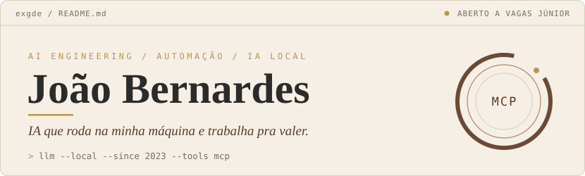
</picture>

 

 

<picture>
  <source media="(prefers-color-scheme: dark)" srcset="./assets/v2/sec-01-dark.svg">
  
</picture>

Rodo modelos de linguagem na minha própria máquina desde 2023. Hoje meu foco é **automação e integração inteligente**: ligar modelos a ferramentas, dados e rotinas reais.

Já passei pelo que quebra na prática: janela de contexto, parâmetros de inferência, custo de GPU e a conexão entre modelo e ferramentas via **MCP (Model Context Protocol)**.

<picture>
  <source media="(prefers-color-scheme: dark)" srcset="./assets/v2/info-dark.svg">
  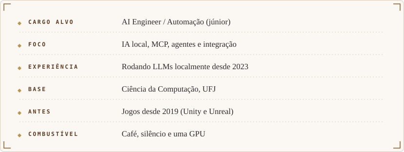
</picture>

 

<picture>
  <source media="(prefers-color-scheme: dark)" srcset="./assets/v2/sec-02-dark.svg">
  
</picture>

<b>IA E DADOS</b> 

<b>AUTOMAÇÃO E INTEGRAÇÃO</b> 

<b>JOGOS E 3D</b> 

 

<picture>
  <source media="(prefers-color-scheme: dark)" srcset="./assets/v2/sec-03-dark.svg">
  
</picture>

<picture><source media="(prefers-color-scheme: dark)" srcset="./assets/v2/card-cutscene-dark.svg">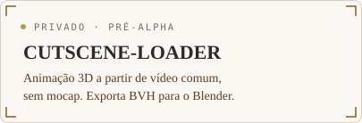</picture>
<picture><source media="(prefers-color-scheme: dark)" srcset="./assets/v2/card-painel-dark.svg">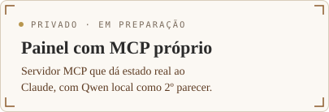</picture>

<picture><source media="(prefers-color-scheme: dark)" srcset="./assets/v2/card-videos-dark.svg">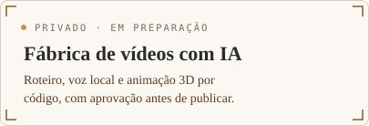</picture>
<picture><source media="(prefers-color-scheme: dark)" srcset="./assets/v2/card-prospeccao-dark.svg">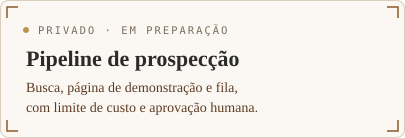</picture>

O código destes quatro ainda é privado. Estou limpando segredos e dados pessoais para abrir.

 

<picture>
  <source media="(prefers-color-scheme: dark)" srcset="./assets/v2/sec-04-dark.svg">
  
</picture>

<a href="https://github.com/exgde/oot-switch2-button-prompts"><picture><source media="(prefers-color-scheme: dark)" srcset="./assets/projetos/button-prompts-dark.svg"></picture></a>
<a href="https://github.com/exgde/oot-lichii-keyboard-mouse"><picture><source media="(prefers-color-scheme: dark)" srcset="./assets/projetos/teclado-mouse-dark.svg"></picture></a>

<a href="https://github.com/exgde/adega"><picture><source media="(prefers-color-scheme: dark)" srcset="./assets/projetos/adega-dark.svg"></picture></a>
<a href="https://github.com/exgde/biblioteca-sql"><picture><source media="(prefers-color-scheme: dark)" srcset="./assets/projetos/biblioteca-sql-dark.svg"></picture></a>

<a href="https://joaobyss.itch.io/goldspotting"><picture><source media="(prefers-color-scheme: dark)" srcset="./assets/projetos/goldspotting-dark.svg"></picture></a>

 

<picture>
  <source media="(prefers-color-scheme: dark)" srcset="./assets/v2/sec-05-dark.svg">
  
</picture>

Procuro vaga júnior em AI engineering ou automação. Também topo freela, colaboração ou só trocar uma ideia sobre IA local e MCP.

[LinkedIn](https://www.linkedin.com/in/joao-bernardes-478749415/) · [E-mail](mailto:jbmidiasxboy@gmail.com) · [itch.io](https://joaobyss.itch.io)

 

feito por joaobyss, com café

